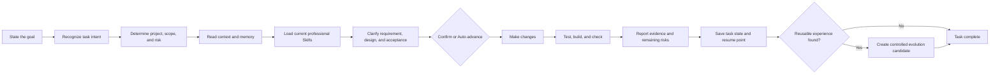
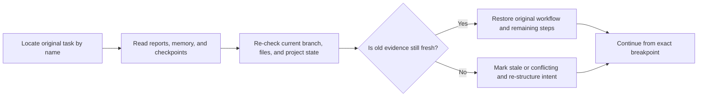

English | [简体中文](README.zh-CN.md)

<h1 align="center">DevCodex</h1>

<p align="center">
  <strong>An intent-driven, cross-host engineering harness for AI Coding</strong>
</p>

<p align="center">
  <strong>Make AI Coding do more than generate code: start from the requirement and keep going until the engineering task is done.</strong>
</p>

<p align="center">
  Recognize intent · Read the project · Invoke professional Skills · Confirm boundaries · Auto-advance · Make changes · Verify results · Save progress · Resume across sessions · Controlled evolution
</p>

<p align="center">
  <a href="https://www.npmjs.com/package/devcodex"></a>
  <a href="./LICENSE"></a>
  =18.17.0" />
  
  
</p>

<p align="center">
  <a href="https://devcodex-labs.github.io/devcodex/">Full documentation</a>
  ·
  <a href="https://devcodex-labs.github.io/devcodex/guide/getting-started">5-minute start</a>
  ·
  <a href="https://devcodex-labs.github.io/devcodex/examples/resume">Cross-session resume example</a>
  ·
  <a href="https://github.com/devcodex-labs/devcodex/issues">Report an issue</a>
</p>

<p align="center">
  <a href="#5-minute-start">Quick start</a>
  ·
  <a href="#how-to-phrase-common-tasks">Common tasks</a>
  ·
  <a href="#faq-and-troubleshooting">Troubleshooting</a>
  ·
  <a href="#updating">Updating</a>
  ·
  <a href="#uninstalling">Uninstalling</a>
</p>

> **The model and the host do the reasoning, write the code, and run the tools. DevCodex starts from the task intent and decides what needs to be done, which project it applies to, what to read, which professional capabilities to load, which engineering process to follow, and how to prove the work is truly complete.**

**Intent-driven · 6 AI Coding hosts · 8 task workflows · 80+ professional Skills · Project context and memory · Sticky Auto advancement · Long-task recovery · Cross-session resume · Evidence-based completion · Controlled self-evolution**

```bash
npm install -g devcodex
cd <your project root>
devcodex init
devcodex status
```

Keep your existing task after installing or updating. If the host offers connection reload, refresh the DevCodex connection and check the currently loaded version; if it does not, save a checkpoint, keep doing the work that can still be done, and reload the host when convenient. A successful install does not mean existing connections have loaded the new version, and there is no need to start a new task just for the update.

Your first task can be phrased like this:

```text
Analyze the three issues most worth solving first in the current project.
First state the read scope and evidence; analyze only, do not modify files.
```

## Contents

- [Why DevCodex?](#why-devcodex)
- [What can you solve after installing?](#what-can-you-solve-after-installing)
- [When to use the host directly, and when to use DevCodex?](#when-to-use-the-host-directly-and-when-to-use-devcodex)
- [5-minute start](#5-minute-start)
- [What installation changes](#what-installation-changes)
- [Workflows, Skills, and host boundaries](#workflows-skills-and-host-boundaries)
- [How to phrase common tasks](#how-to-phrase-common-tasks)
- [FAQ and troubleshooting](#faq-and-troubleshooting)
- [Updating](#updating)
- [Uninstalling](#uninstalling)
- [Boundaries](#boundaries)
- [Documentation](#documentation)
- [Contributing](#contributing)
- [Community](#community)
- [License](#license)

---

## Why DevCodex?

Models keep getting better at writing code, but real engineering tasks still often fail outside of code generation:

- A new session knows nothing about the project, so the background has to be explained every time;
- The AI starts modifying files before the requirement is even clear;
- Long tasks that span files and phases easily drift from the goal;
- After a session is interrupted, all you can do is guess where things stopped from an old chat summary;
- General-purpose models lack the professional engineering methods the current problem needs;
- Simple tasks and high-risk tasks are handled the same way;
- "It's done" comes with no tests, evidence, or remaining risks;
- The same problems keep recurring without being turned into capabilities reusable next time;
- After switching between Codex, Claude Code, or Cursor, the project's way of working has to be maintained all over again.

DevCodex fills exactly this missing layer between AI Coding and real software engineering.

| Relying only on the current AI Coding session | With DevCodex |
|---|---|
| Background lives mostly in the chat window | Project context, task state, reports, and memory are saved with the project |
| Tends to start coding as soon as it gets a requirement | First determines the goal, project, scope, risk, and whether changes are allowed |
| Relies mainly on the model's general abilities | Loads the matching professional Skills for the task and phase |
| Long tasks restart analysis from scratch after an interruption | Continues from task identity, checkpoints, confirmation state, and remaining items |
| Large projects are re-read every round | Incremental analysis and re-verification based on change scope and impact |
| "Code written" equals "task done" | Tests, builds, reports, evidence, and remaining risks close the task together |
| Project experience is scattered across conversations | Recurring problems can become controlled evolution candidates and project Skills |
| Each tool maintains its own rules | Six hosts reuse the same project engineering method |

### Intent-driven: you state the goal, DevCodex decides how to work

DevCodex does not require users to learn workflow names first, and it does not mechanically apply a fixed prompt whenever it sees a keyword. It first structures the result you actually want, then lets that structured intent drive the downstream project recognition, context, Skills, process, Auto/confirmation, execution, and verification. Downstream components may not each reinterpret the raw text.

It determines, all at once:

- Whether the final need is a conclusion, a code change, a bug fix, a system review, or continuing a past task;
- Which project the request applies to, and which directories, modules, and business scope may be touched;
- How risky the current task is, and whether modifying files is allowed;
- Which Profile, relevant source code, past memory, and verification evidence need to be read;
- Which professional Skills should be loaded in the current phase;
- Which points need user confirmation and which can be advanced continuously by Auto;
- Which verifications should run, and under what conditions completion can be declared.

| Your request | Engineering path after DevCodex recognizes it |
|---|---|
| "Analyze why the tests fail, don't modify anything" | Enters read-only analysis, stating the read scope, evidence, and unverified parts |
| "Reproduce and fix this failing test case" | Enters the fix process: reproduce, locate the root cause, then modify and regress |
| "Add idempotency to the payment callback" | Enters the development process: clarify requirement, design, scope, and acceptance first |
| "Review the risks in the current payment flow" | Enters evidence-based review; does not modify files by default |
| "Continue the payment callback idempotency task" | Locates the original task, re-checks the current state, and resumes from the exact breakpoint |
| "Is this design reasonable?" | First determines whether only analysis and advice are needed, or an actual change in the end |

Intent is not a one-off classification label; it is the control starting point of the whole engineering chain:

```text
User goal
→ Task type
→ Target project, scope, and risk
→ Context and memory
→ Professional Skills
→ Workflow and confirmation mode
→ Verification and completion criteria
```

When the user's goal changes, for example from "analyze only" to "implement the plan", from a single project to the whole workspace, or when commit and release requirements are added on the fly, DevCodex re-structures the intent and then refreshes the workflow, context, permissions, and verification boundaries together. A scope change or an expired short-lived credential does not by itself turn into a user confirmation.

> Auto only keeps advancing within the already recognized intent and authorized scope. It does not bypass intent judgment, and it does not automatically turn a read-only analysis into a code change.

### A complete loop from requirement to delivery



DevCodex is not just an extra prompt stuffed in at the start; it continuously manages the whole task, from understanding and execution to verification and handoff.

### Why does the same model behave smarter?

DevCodex does not change model parameters. It improves the AI's effective performance in real projects through four things:

1. **The right goal**: first determine whether the end result is a conclusion, a fix, a feature, a review, or a resume;
2. **The right material**: read only the project conventions, source code, memory, and evidence the current task needs;
3. **The right capability**: load the matching professional Skills in the current phase instead of stuffing in every rule at once;
4. **Real feedback**: tests, builds, command results, code diffs, and review evidence keep influencing subsequent judgments.

Simple tasks can take a shorter path; when public contracts, data, security, multiple modules, or release risk are involved, review and verification intensity are raised automatically. Whether confirmation is needed is decided only by the current structured intent and action authorization; risk labels, reviewers, and verifiers cannot demand confirmation on their own. Process ceremony, design depth, and verification scope are judged separately, rather than one vague "simple/complex" label controlling all three: the user's explicit wording in the current task takes precedence, followed by project configuration, smart recognition based on project facts, and a conservative fallback. The entry point makes an initial judgment, judges again after reading the project, and in PC8–PC10 spells out the process/design, verification scope and estimated time, next phases, and whether a user action is currently needed.

A Profile can set `extensions.devcodex.workflowRouting.mode` to `adaptive` (default), `simple`, or `standard`, and use `showPlan` to control display density. This setting only provides the default for process ceremony; it cannot lower mandatory obligations such as public contracts, state recovery, package, or release. The PC0 entry check also shows the version relationship between the installed package, the current runtime, and source candidates, so that "same version number" is not misreported as "exactly the same content".

How an artifact is opened depends on the actual presentation surface, not just the host name. Codex Desktop outputs real local file links; VS Code, Zed, and JetBrains can output the corresponding open commands; unknown or unverified interfaces get a copyable absolute path directly. The system only writes "opened" when the open action was executed and read back successfully; a renderer selection, a generated command, or a rendered link does not pass itself off as a successful open.

### Auto advancement: authorize once, complete the whole engineering chain

In normal mode, DevCodex waits for confirmation at key points such as requirement, design, and implementation plan. When you want the AI to keep advancing within an authorized scope, you can enter Auto explicitly:

```text
@devcodex-auto Complete the payment callback idempotency fix.
First reproduce and confirm the root cause, then complete the design, changes, related regression, report, and task closure;
do not expand to deletion, push, or release.
```

Auto does not skip the engineering process. Instead it **automatically passes the applicable process confirmations and continues with the subsequent analysis, implementation, verification, reporting, and state saving**:

- A valid entry is first structured as `executionDecision=enable-auto`; once a formal task is established, task-level Auto carries it forward continuously, without relying on a short-lived receipt or session TTL, and without needing "continue" replies at every phase;
- Requirements, designs, implementation plans, tests, evidence, and reports are still produced; they do not disappear because of auto-advancement;
- Recoverable failures are retried automatically at most 2 times; when the actual change scope expands, evidence becomes stale, or verification fails, the current action stops, the intent is re-structured, and work continues if the original authorization still applies, without mechanically switching back to confirmation;
- Deletion, writes outside the project, dangerous operations, push, Tag, Release, and publishing are not authorized automatically by entering Auto;
- Hosts differ in their support for Hooks, permissions, and automatic approval; when a capability is lacking, the corresponding action stops with a clear notice, without overriding the structured Auto decision.

The formal entry is `@devcodex-auto`, and the default shortcut alias is `@rocky`. Exit with `退出 auto` (exit auto), `关闭自动模式` (turn off auto mode), or `切回确认模式` (switch back to confirmation mode). On recovery, a formal task resumes by task identity and structured intent; task-level authorization cannot be revoked merely because of a new session or an expired short-lived credential.

> The value of Auto is not "skipping steps"; it is that tasks with a clear goal and boundaries are no longer interrupted by mechanical confirmations, while verification, evidence, and safety baselines are kept.

<details>
<summary><strong>Set up your team's own Auto alias</strong></summary>

In the Profile's `config.json`, set:

```json
{
  "extensions": {
    "devcodex": {
      "autoAliases": ["@team-auto"]
    }
  }
}
```

A non-empty array replaces the default shortcut alias `@rocky`; an empty array `[]` turns off the default shortcut alias. The formal entry `@devcodex-auto` is never renamed.

</details>

---

## What can you solve after installing?

### 1. Cross-session recovery: tasks are no longer trapped in old chat windows

DevCodex's resume is not "read an old session summary and keep guessing".

For formal tasks, it continuously saves recoverable engineering state, including:

- Task identity and original goal;
- Confirmed scope, non-goals, and acceptance criteria;
- Current workflow and phase;
- Completed steps, pending steps, and where it stopped;
- Modified files and key decisions;
- Verifications run, results, and evidence;
- Remaining risks, blockers, and next steps;
- Permissions the original task has and has not been granted.

When a new session receives:

```text
Continue the payment callback idempotency fix task.
```

it first completes the following recovery process:



After recovery the original boundaries still apply: if the original task was read-only, it stays read-only after resuming; if the original task had no `push` or release permission, it does not gain one by switching sessions.

A formal task itself does not expire because of waiting, shutdown, network loss, host exit, or a version upgrade. What expires in the short term is the fenced owner: just a write lease that prevents two sessions from writing the same task at once, with a default idle lease of 5 minutes. After the lease expires or an accepted Stop releases it, the task identity, overview, CP confirmations, reports, memory, and checkpoints remain. A new session can send `继续 <exact task name>` (continue <exact task name>); DevCodex re-checks the project root, TaskIdentityV2, overview, CP summary, and old turn/operation state on the server side and performs a single-winner CAS. On success it generates a new admission generation and owner generation together, with no need to rewrite the task or re-confirm the same CP.

If the old owner is still valid, an old tool operation has not been closed out, the task truth has drifted, the task is already terminal, or another session completed the takeover first, recovery fails closed and returns an actionable typed next step (wait for the lease, complete/reconcile the old operation, repair the drift, explicitly reopen, or read the winner), rather than misreporting "takeover refused" as "task lost".

This brings several practical results:

- No need to re-paste dozens of rounds of old conversation;
- Similar tasks are not wrongly chained together;
- Confirmed scope is not forgotten just because the session changed;
- When the current code has changed, a stale plan is not reused directly;
- Unfinished tasks can be handed to a new session to continue;
- Between supported hosts, work can also be relayed based on task files, reports, and evidence in the same project.

> Cross-host relay reuses the project's engineering state; it does not unconditionally carry over a host's full chat session. Hooks, MCP, permissions, and automation strength still depend on the target host.

<details>
<summary><strong>Why is long-task recovery more reliable?</strong></summary>

- Recovery state is saved per formal task, rather than generating a full snapshot on every Hook or tool event;
- Each task uses a stable checkpoint; when a write fails, the previous valid state is kept;
- Tasks that have reached a safe breakpoint can be condensed into a smaller recovery record;
- Finished tasks leave the active recovery area and do not keep producing meaningless state;
- State storage has byte-based capacity protection and does not silently delete active tasks when it hits the pressure limit;
- Ordinary read-only events do not keep writing the full task state.

These mechanisms make cross-session recovery suitable for genuinely long tasks, not just short conversational demos.

</details>

See the full example in [Cross-session resume](https://devcodex-labs.github.io/devcodex/examples/resume).

### 2. Project Profile, context, memory, and reusable project knowledge

**Think of the Profile as the engineering manual the AI uses for the current project.** It records the project structure, tech stack, build and test commands, code style, architecture boundaries, release process, feature list, and user contracts, so the AI does not have to re-guess the project rules from the directory tree and `package.json` every time.

`devcodex init` generates an **evidence-backed Profile draft and template**, not finished facts. After initialization, have the AI go on to read the real source code, scripts, CI, docs, configuration, and release process to turn the template into an engineering baseline the project can rely on. Anything that cannot be proven from the project must stay `unverified` and must not be made up.

The Profile is not a cache that stays correct forever either. Project-level analysis and review reconcile the Profile's claims against the current code, configuration, and runtime evidence; when drift is found, the currently verifiable facts win, and revising the Profile becomes a follow-up task.

Without a complete Profile, DevCodex can still read the current files and handle limited tasks, but it loses a reliable project-level engineering baseline: `status` / `doctor` show `missing` or `partial`, the run mode uses the more conservative `prod` default (this only means a conservative rule mode, not automatic deployment to production), project facts that cannot be confirmed remain unverified, and tasks that depend on build, test, release, or architecture boundaries may ask for more information, downgrade, or stop. In a multi-project workspace, if the target project's Profile root is missing entirely, `PROFILE_MISSING` is returned rather than wrongly using another project's Profile.

DevCodex handles three kinds of information separately:

| Type | What it solves |
|---|---|
| **Project description** | How the project is built, tested, and released; its directories, tech stack, and security boundaries |
| **Current context** | Which code, docs, configuration, and evidence this task actually needs to read |
| **Task memory** | What has been confirmed, done, and verified, and what remains |

In large, multi-round project analysis, verified stable facts, file relationships, and impact scopes can also be turned into reusable project knowledge:

- When files have not changed and evidence is still valid, there is no need to re-analyze every round;
- When files change, only the changed files and their dependencies, consumers, configuration, and test scope are invalidated;
- When the analysis goal changes but the code does not, only the new analysis perspective is added;
- When snapshots, file identities, or sampled re-verification disagree, it automatically falls back to a full read;
- Large projects can deliver results in batches instead of producing a single summary after a long silence.

This is not "caching a natural-language summary"; it is project knowledge with sources, scope, freshness, and invalidation conditions.

### 3. When intent changes, process and permissions are re-judged

Intent recognition is not a one-off label at the start of a task. When the user adds scope, changes the end goal, switches projects, or changes from "analyze only" to "implement the plan", DevCodex re-judges:

- Whether to continue the original workflow or switch to development, fix, analysis, review, or resume;
- Whether new project context and memory need to be read;
- Whether professional Skills need to be added or removed;
- Whether the original read-only, modify, commit, and release permissions still hold;
- Whether existing plans, evidence, and verification scope have gone stale.

This prevents the AI from carrying on with the old process, old context, or old permissions after the user's goal has changed, just because the first round of judgment is already done.

### 4. 80+ professional Skills, added on demand

DevCodex ships with 80+ professional Skills, covering:

- Requirement clarification, product strategy, acceptance, and technical design;
- Frontend, interaction, design systems, and accessibility;
- Backend, domain modeling, APIs, data, and distributed systems;
- Security, privacy, external integrations, and threat modeling;
- Bug reproduction, root cause, regression scope, testing, and review;
- Performance, production readiness, SRE, release, and documentation sync;
- Context, memory, host capabilities, Skill lifecycle, and engineering governance.

Skills are loaded only when they match the current task and phase. A Skill existing in the repository does not mean all of it has been sent to the model.

Projects can also add their own Skills, turning business rules, team conventions, architecture constraints, common problems, and verification methods into engineering capabilities the AI can reuse.

### 5. From requirement to verification, tasks are not allowed to drift silently

New features start from goals, scope, non-goals, and acceptance; complex tasks also produce a design, implementation order, verification, and rollback strategy.

If, during execution, the actual scope expands significantly, or a new public contract or high-risk operation appears, DevCodex pauses and returns to the confirmation phase, rather than quietly expanding an ad-hoc discovery into a new requirement.

### 6. Evidence-based completion: not "the AI says it's done", but done with evidence

Completion has to answer:

- What was changed;
- Why it was changed this way;
- Which tests, builds, or checks were run;
- What the command results were;
- Which scope has been verified;
- Which scope has not been verified;
- What risks remain;
- Whether committing, pushing, or releasing is needed next.

Verification that was not run cannot be reported as passed; a test success does not automatically grant commit or release authorization.

### 7. Controlled self-evolution: turning project experience into assets, step by step

When a type of problem keeps recurring, a process is often reworked, or existing Skills cannot cover something, DevCodex can:

```text
Recurring problem / rework / new experience
        ↓
Identify capability gap and root cause
        ↓
Create Skill, rule, Prompt, or verification candidate
        ↓
Small-scale trial run and effect verification
        ↓
Human review and approval
        ↓
Settle into a workspace or project capability
```

By default, candidates do not go directly into the actual workflow, nor do they automatically override current rules or get released. Only with a clear goal, sufficient evidence, the correct destination, and authorization are they promoted to usable capabilities; ineffective or harmful improvements can be rejected, rolled back, or retired.

**This is not letting the AI modify itself at will; it is letting verified engineering experience accumulate safely.**

#### How does an evolution candidate actually become a Skill?

```text
Evidence of recurring problems or rework
        ↓
Written to the evolution/candidates area
        ↓
Decide whether it belongs to the workspace, a single project, or the upstream package
        ↓
Fill in applicable scenarios, counterexamples, verification, and rollback evidence
        ↓
Human-approved promotion
        ↓
Generate SKILL.md + intent.json into the active directory
        ↓
Test routing with natural-language positive and negative examples; revise or roll back on failure
```

Key boundaries:

- The candidate area is not an active Skill directory; generated candidates do not automatically take part in task routing;
- By default they are settled as workspace Skills first; only when they clearly depend on a single project do they become project-level Skills;
- Modifying DevCodex's upstream built-in Skills requires separate maintainer authorization and cannot be written back into the distribution package automatically by an ordinary project;
- Only when the candidate, target location, verification evidence, and promotion authorization are all in place can the AI generate the final `SKILL.md` and `intent.json`;
- After generation, positive examples, negative examples, and real natural-language requests are still used to verify "when it should load and when it should not".

`devcodex init` only prepares isolated directories; it does not automatically turn every conversation into a Skill:

```text
.devcodex/workspace/evolution/candidates/   Candidates
.devcodex/workspace/evolution/evidence/     Problem, trial-run, and effect evidence
.devcodex/workspace/evolution/decisions/    Target, approval, and promotion decisions
```

After approval, the active target is decided by the reuse scope:

| Target | Active directory | Constraint |
|---|---|---|
| workspace Skill | `.devcodex/workspace/skills/<id>/` | Default choice, reused within the same workspace |
| project Skill | `.devcodex/<project>/skills/<id>/` | Requires project-specific evidence |
| DevCodex upstream Skill | `content/skills/<id>/` | Requires explicit maintainer authorization and going through the release process again |

The current public CLI has no "one-click turn a candidate into an active Skill" command. Promotion is done by a controlled AI workflow: first form and approve the target decision, then have `workspace-skill-author` generate `SKILL.md` and `intent.json`, and finally run positive/negative example and natural-language routing verification.

You can ask for it directly like this:

```text
Review the evolution candidates in the current workspace and find those related to duplicate payment callback handling.
First decide whether it should be settled as a workspace Skill or a project Skill, and list the evidence, applicable scenarios, counterexamples, verification, and rollback plan.
Do not promote without my approval; after I confirm, generate SKILL.md and intent.json and test routing with natural-language positive and negative examples.
```

Even without past candidates, you can create the project's own Skill directly:

```text
Create a payment-webhook-reliability Skill for the current workspace.
It is for payment callback idempotency, signature verification, state machines, duplicate notifications, and compensation checks;
also generate applicable scenarios, positive and negative examples, and verification steps, and test routing once with natural language.
```

### 8. Six AI Coding hosts reuse the same way of engineering

DevCodex currently targets:

```text
Codex · Claude Code · GitHub Copilot · Gemini CLI · Grok · Cursor
```

Project context, task memory, professional Skills, confirmation boundaries, verification, and reports are kept as consistent as possible, while the executable path is chosen according to the Hooks, MCP, plugins, permissions, and lifecycle events each host actually supports.

When a host capability is missing, DevCodex downgrades, warns, or keeps it unverified, rather than pretending the six tools are exactly the same.

### 9. Context reuse, without trading correctness for speed

When the task, session, project, context version, and body identity are all exactly the same, and the confirmed body has already been delivered, DevCodex can reuse a lightweight description to avoid re-sending the same large block of content.

If any identity or content changes, it goes back to a full read. This cuts meaningless repetition without letting the AI keep working on stale context because of a bad cache.

### 10. Multiple tasks: judge whether they can safely run in parallel

When a project has several requirements, issues, or optimization tasks at once, DevCodex can first check:

- Whether they modify the same files;
- Whether they compete for the same task state, reports, or memory;
- Whether they share configuration, release files, or verification entry points;
- Whether there is a clear merge order, conflict check, and stop condition.

Parallelism is suggested only when both the write surface and the merge protocol can be proven safe; when that cannot be proven, work stays serial. It is not a general multi-agent orchestration framework, but it can avoid engineering conflicts caused by "parallelism for its own sake".

### 11. Permissions, Git, and release actions are not amplified endlessly by a single sentence

Analyzing, modifying, deleting, committing, switching branches, pushing, Tag, Release, and publishing are different actions.

DevCodex keeps the current branch by default and does not automatically create branches, commit, push, or release for ordinary development tasks. Dangerous operations, writes outside the project, or cleanup require more explicit authorization and a provable target scope.

### 12. State, diagnostics, and recovery paths are inspectable

```bash
devcodex status
devcodex doctor --json
devcodex runtime status --json
devcodex runtime maintenance --dry-run --json
devcodex governance ledger init --apply --json
devcodex governance ledger plan --kind GR --json
```

Status distinguishes "configuration present", "adapter contract passed", "native host verified", and "end-to-end usable", and never passes off the existence of files as real capability.

A normal non-dry-run `init` / `update` initializes the governance ledger manifest with zero migration and rebuilds derived indexes, without rewriting existing Markdown ledgers. Historical sharding is not executed automatically: `governance ledger plan` is a read-only preview; after confirming the candidate, use `devcodex governance ledger apply --kind GR --plan <sha256> --json`, and roll back by running `rollback` with the same exact digest. The active ledger is always the sole write target; archive shards are read-only history.

---

## When to use the host directly, and when to use DevCodex?

| Scenario | Better choice | Reason |
|---|---|---|
| One-off Q&A, tiny edits, or relying only on a host-specific tool | Use the host directly | Fastest; no task state, reports, or resume chain needed |
| Cross-file or cross-module development | DevCodex | Needs requirement, design, execution boundaries, and a verification loop |
| Fixing a bug while worried about similar regressions | DevCodex | Chains together reproduction, root cause, similar paths, and targeted regression |
| Incomplete requirements or higher risk | DevCodex | Clarifies scope, non-goals, acceptance, and authorization first |
| Long tasks spanning multiple sessions | DevCodex | Saves task identity, checkpoints, evidence, and remaining items |
| Large projects needing multi-round analysis | DevCodex | Supports batched delivery, project knowledge, and selective invalidation |
| Audit, handoff, or leaving evidence is needed | DevCodex | Reports, verification results, and uncovered scope can be inspected |
| You want team experience to keep accumulating | DevCodex | Can create project Skills and controlled evolution candidates |

DevCodex does not replace hosts such as Codex, Claude Code, or Cursor. The host provides the model, interface, and native tools; DevCodex provides the project-level engineering way of working.

---

## 5-minute start

### 1. Check the environment

Requires Node.js `>=18.17.0` and npm.

```bash
node -v
npm -v
```

### 2. Install

```bash
npm install -g devcodex
devcodex --version
```

A normal install refreshes the user-level host adapters. If the package manager has install scripts disabled, or a later `status` shows the adapters are not ready, run:

```bash
devcodex global-adapters apply
```

### 3. Initialize the project

```bash
cd <your project or workspace root>
devcodex init
devcodex status
```

`devcodex init` prepares the `.devcodex/` runtime directory, task state, memory, workspace Skills, and evolution candidate directories, and generates a basic Profile draft for the workspace. It does not automatically modify business source code, and it does not treat unconfirmed template content as project facts. If you want to see what will be created first, run `devcodex init --dry-run`.

#### After initialization: have the AI complete the project Profile (strongly recommended)

First preview the Profile tier that suits the project, then generate the templates you need:

```bash
# First check the current tier, the recommended tier, and the files to be generated
devcodex profile plan

# Then choose a tier based on the actual project; a typical business project is used as an example below
devcodex profile init --tier profile-standard

devcodex status
```

Then, in a new session for the current project, just say:

```text
Complete the DevCodex Profile for the current project.
Read the real package.json, directory structure, source code, lint/test/build scripts, CI, docs, configuration, and release process,
and fill in the project structure, architecture boundaries, code style, testing conventions, release conventions, and feature list item by item.
Only write facts that can be proven from project evidence; keep anything that cannot be confirmed as unverified, do not make things up.
When done, check that the Profile matches the current code, and run devcodex status and devcodex doctor --json.
```

`status` / `doctor` mainly check the Profile's paths, tier, required files, and structural state; whether the Profile truly matches the business and source code is still determined by the AI's evidence-based review and the user's confirmation.

<details>
<summary><strong>Profile tiers, multiple projects, and override rules</strong></summary>

| Profile tier | Suitable projects | Main contents |
|---|---|---|
| `profile-lite` | Small projects or a first try | Project info, architecture constraints, code style, and basic configuration |
| `profile-standard` | Most real business projects | Adds testing conventions, release conventions, and a feature list |
| `profile-closed-loop` | SDKs, CLIs, frameworks, public APIs, or documentation sites | Further adds user docs and contract conventions |

`profile plan` only previews and writes no files; existing files are kept by default, and upgrading a tier only adds missing content. `--force` may overwrite DevCodex-managed Profile files, so review the plan and the Git diff before running it.

A multi-project workspace can initialize a specific project on its own:

```bash
devcodex init --profile <project relative path> --dry-run
devcodex init --profile <project relative path>
```

The workspace Profile serves as the shared baseline, and a project Profile only overrides that project's own differences, so one project's rules are not wrongly applied to another.

</details>

### 4. Check what the original host has loaded

The published version, the locally installed version, and the version the current host has loaded are verified separately. Connection reload is provided by the host: when there is a verifiable channel, reload within the original task; when there is none, keep the original task and checkpoint and continue the work that can be done. `devcodex doctor --json` succeeding in a new process does not mean the existing MCP connection has switched versions.

### 5. Start your first task

```text
Analyze the three issues most worth solving first in the current project.
First state the read scope and evidence; analyze only, do not modify files.
```

You should see:

- It first recognizes the task intent, target project, and read/write boundaries;
- It states which materials were read and which were not;
- Conclusions point to code, configuration, docs, or command results;
- Inferences and unverified scope are clearly marked;
- No business files are modified during a read-only analysis.

See the full steps in [5-minute start](https://devcodex-labs.github.io/devcodex/guide/getting-started).

---

## What installation changes

| Location | Behavior |
|---|---|
| User HOME | Installs or refreshes DevCodex-managed host adapters and runtime files |
| Current project / workspace | Creates or refreshes `.devcodex/` after running `devcodex init` |
| Business source code | Not modified automatically by installation or initialization themselves |
| Background services | Normal use does not start any resident DevCodex network service |
| Host-native configuration and Skills | Does not scan, copy, merge, overwrite, or delete the user's own assets |

Project descriptions, task state, reports, memory, and project Skills are saved in the project directory by default. Model reasoning, networking, authentication, sandboxing, and data processing remain the responsibility of the AI Coding host you choose.

DevCodex does not proxy model requests, and it does not exaggerate "project state is saved locally" into "code never leaves your machine"; whether the host uploads context, saves chats, or uses networked tools depends on that host and your organization's policies.

> The current version of `devcodex init` generates a basic Profile draft; it only establishes an editable template and detected facts. The final Profile should still be completed by the AI against the real project and confirmed by the user or team.

---

## Workflows, Skills, and host boundaries

### 8 task workflows

Users do not need to learn workflow names first. Once you state the end goal, DevCodex chooses the appropriate path.

| Workflow | Purpose | Modifies files by default? |
|---|---|---:|
| `dev` | Feature development, refactoring, or documentation work | After confirmation |
| `fix` | Reproduce, locate, and fix problems | After confirmation |
| `analyze` | Read-only analysis and research | No |
| `audit` | Evidence-based system review | No |
| `resume` | Resume an existing task | Inherits the original task's boundaries |
| `chat` | General conversation | No |
| `self-fix` | Fix DevCodex's own rules or processes | Advanced entry, after confirmation |
| `other` | Plan first when it cannot be safely classified | No |

Of these, `dev`, `fix`, `analyze`, `audit`, `resume`, and `chat` are the six main workflows; `self-fix` and `other` are advanced or fallback paths.

### 80+ professional Skills

The public summary uses **80+**. Current Skills cover four categories of capability:

| Category | Main contents |
|---|---|
| Workflow & Routing | Task judgment, phases, confirmation paths, development, fix, analysis, and review |
| Domain & Architecture | Product, experience, frontend and backend, API, data, security, performance, and system architecture |
| Quality & Delivery | Testing, review, documentation, verification, reporting, release, and delivery closure |
| Runtime & Governance | Hosts, context, memory, Skill lifecycle, policy, and runtime governance |

Workspace Skills are project-level extensions; they are not automatically mixed into the built-in Skill count, and they do not go directly from evolution candidates into active routing without approval.

### Entry points and current boundaries for the six hosts

| Host | Recommended entry | Notes |
|---|---|---|
| GitHub Copilot | Copilot CLI; VS Code / JetBrains use the instructions fallback | Capabilities differ by entry point |
| Claude Code | Claude Code | Scope follows current direct evidence of support |
| Codex | Codex App / CLI | Hook and MCP capabilities depend on host configuration |
| Gemini CLI | Gemini CLI | Adapter exists; kept unverified while real replay evidence is insufficient |
| Grok | `devcodex grok` | Using the DevCodex launcher is recommended |
| Cursor | Local IDE / CLI | Local and Cloud Agent must be judged separately |

For exact compatibility status, see [Six-host capability boundaries](https://devcodex-labs.github.io/devcodex/reference/hosts).

### What are DevCodex and the host each responsible for?

| DevCodex is responsible for | The AI Coding host is responsible for |
|---|---|
| Task and project recognition, context, memory, and professional Skills | Model reasoning and the native agent loop |
| Confirmation and authorization boundaries, verification, reports, evidence, and resume | Primary tool execution, session transport, and lifecycle |
| Six-host adaptation and shared engineering process | Authentication, sandboxing, networking, and runtime environment |

---

## How to phrase common tasks

### Develop a feature

```text
Add <feature> to the current project.
First lay out the goal, scope, non-goals, and acceptance criteria, then propose a design.
Modify only after I confirm; when done, run the relevant verification and report remaining risks.
```

### Fix a bug

```text
Fix <problem>.
First reproduce it and locate the root cause, and check similar paths and the regression scope.
Modify only after the design is confirmed; when done, use verification evidence to prove the original problem is gone.
```

### Read-only analysis

```text
Analyze the three issues in the current architecture most worth solving first.
Give code evidence, impact, and priority; analyze only, do not modify files.
```

### System review

```text
Review the current project's payment callback, idempotency, and state consistency.
Read-only, do not modify files; sort by risk and give evidence and unchecked scope.
```

### Continue a past task

```text
Continue the payment callback idempotency fix task.
First read the original task's confirmation state, reports, verification evidence, and remaining risks,
re-check whether the current code has changed, then continue from the exact breakpoint.
```

### Incremental analysis of a large project

```text
Deeply analyze the current project and deliver results in batches by module.
Save reusable project knowledge; afterwards only recompute changed files, impact scope, and new analysis perspectives.
Give evidence, coverage, and a checkpoint for every batch.
```

### Analyze capability gaps and form evolution candidates

```text
Analyze recently recurring rework, regressions, and user feedback.
Find gaps in current Skills or processes, and generate improvement candidates and a verification plan.
Do not let candidates take effect automatically for now, and do not release them.
```

### Judge whether multiple tasks can run in parallel

```text
Check whether the three tasks below can safely run in parallel.
List each one's allowed paths, shared state, conflict risks, merge order, and stop conditions;
keep them serial when safety cannot be proven.
```

### Use Auto advancement

```text
@devcodex-auto Complete the current requirement.
Start from the requirement and project facts, and automatically advance through the applicable confirmations, design, implementation, verification, reporting, and task state saving;
stop and report when the scope expands, verification fails, or a high-risk action comes up.
You may modify files within the confirmed scope of the current project, but do not delete, push, Tag, Release, or publish.
```

The formal auto entry is `@devcodex-auto`, and the default shortcut alias is `@rocky`. A non-empty `extensions.devcodex.autoAliases` array replaces the default alias, and an empty array `[]` turns it off. Auto stays in effect within the same session; type `退出 auto` (exit auto) or `切回确认模式` (switch back to confirmation mode) to exit. The auto entry does not expand deletion, push, or release permissions.

For more examples, see [Common tasks](https://devcodex-labs.github.io/devcodex/guide/common-tasks) and [Task tutorials](https://devcodex-labs.github.io/devcodex/tutorials/ambiguous-request).

---

## FAQ and troubleshooting

### Does DevCodex make the model itself stronger?

It does not change model parameters, weights, context window, or the base reasoning ceiling. Through the right goal, project context, professional Skills, workflows, tools, memory, verification, and an evidence chain, it makes the same model more reliable in real engineering.

### What does cross-session recovery require?

Task progress, confirmation state, and verification evidence must already be written to the project. A task that exists only in a chat window and left no state in the project cannot be recovered reliably.

### Can I switch from Codex to Claude Code or Cursor and continue?

You can relay based on the requirements, reports, task memory, and checkpoints in the same project, but the full chat session is not copied unconditionally. The target host needs to be able to read those project files, and specific Hook, MCP, and auto-execution capabilities still depend on what the host actually supports.

### If the current files have changed, will it just continue with the old plan?

Old records are not treated as permanent truth. Resume re-checks the current project, branch, file identities, and evidence freshness; when conflicts, staleness, or scope drift appear, the intent is re-structured first, and the result decides whether to continue, stop, or enter confirmation mode.

### Will DevCodex modify, commit, or release automatically?

`analyze` and the default `audit` are read-only; for `dev` and `fix`, the structured intent chooses confirm or Auto. Auto automatically passes the applicable engineering confirmations, and formal task authorization can be restored along with the task; commit, push, Tag, GitHub Release, and npm publish still require separate, explicit authorization per action.

### Will using a harness make every small task slower?

Not every task is handled with the same intensity. Low-risk small tasks with clear scope can take shorter artifact and verification paths; public contract, data, security, multi-module, and release tasks use stricter confirmation and review.

### Why don't I see workflows or Skills after installing?

In the original task, check whether the connection has been refreshed, then run:

```bash
devcodex status
devcodex doctor --json
devcodex global-adapters apply
```

Do not judge that a capability is in effect just because a configuration file exists. configured, adapter contract, native probe, and final readiness in the status are different layers of evidence.

### Will data leave my machine?

Normal use of DevCodex needs no resident network service of its own and does not proxy model requests; but the actual model calls and data processing are done by the current host. Whether code is uploaded, chats are saved, or networked tools are enabled depends on the host, your account, and your organization's policies.

### Can I add the project's own Skills?

Yes. Workspace Skills can capture business rules, architecture constraints, team processes, and verification methods. You can ask the AI to create one directly, or promote one from an evolution candidate after evidence, target judgment, and human approval. Candidates never become active Skills directly.

### How do I troubleshoot abnormal status?

```bash
devcodex status --json
devcodex doctor --json
devcodex runtime status --json
```

See the full decision tree in [Troubleshooting](https://devcodex-labs.github.io/devcodex/guide/troubleshooting).

---

## Updating

First update the npm package and the user-level host adapters:

```bash
npm update -g devcodex
devcodex --version
devcodex global-adapters apply
```

Then go into the project or workspace in use, and preview and refresh the project runtime content:

```bash
cd <your project or workspace root>
devcodex update --dry-run
devcodex update
devcodex status
```

`devcodex update` only refreshes the current workspace's DevCodex runtime content; it does not automatically overwrite or upgrade a Profile already maintained by the team. When project facts change, have the AI review and update the Profile separately.

After updating, keep the original task and check the version actually loaded by the current host connection. Reload that connection when possible; when that capability is unavailable, keep the checkpoint, continue the work that can be done, and reload the host later when convenient.

---

## Uninstalling

First preview the DevCodex-managed user-level assets, then clean up explicitly, and finally uninstall the npm package:

```bash
devcodex uninstall --dry-run
devcodex uninstall --apply
npm uninstall -g devcodex
```

Do not run `npm uninstall -g devcodex` first, otherwise the command that safely cleans up the host adapters disappears along with it.

A normal uninstall only removes user-level host adapters and runtime assets that can be proven to be managed by DevCodex:

- The user's own host configuration, instructions, native Skills, and personal assets are kept;
- Files whose ownership cannot be proven are not risked for deletion;
- The project's `.devcodex/` is kept by default, because it may contain the Profile, requirements, issues, reports, task memory, checkpoints, workspace Skills, and evolution candidates;
- If you reinstall later, you can keep using these project engineering assets.

If you are sure you want to permanently abandon DevCodex data in a project, first back up or review `.devcodex/`, then delete it manually yourself. DevCodex does not automatically wipe project history during a global uninstall.

---

## Boundaries

- DevCodex is not a new Coding Agent, nor a model gateway;
- It is not a general agent framework or a multi-agent orchestrator;
- It does not replace business frameworks, GitHub CI, security audits, or human review;
- It does not magically give the six hosts exactly the same Hooks, MCP, plugins, and permissions;
- Saving project state in local files does not mean data processed by the host never leaves your machine;
- Verification that was not executed cannot be claimed as passed;
- Reports and memory can help recover tasks, but cannot bypass current code facts or regain permission for dangerous operations;
- Controlled evolution only generates candidates by default and does not modify active rules or release without approval.

For more, see [Trust, security, and data](https://devcodex-labs.github.io/devcodex/guide/trust-security-data) and [Limits and boundaries](https://devcodex-labs.github.io/devcodex/reference/limits).

---

## Documentation

- [5-minute start](https://devcodex-labs.github.io/devcodex/guide/getting-started)
- [Auto advancement and common tasks](https://devcodex-labs.github.io/devcodex/guide/common-tasks)
- [Intent-driven](https://devcodex-labs.github.io/devcodex/concepts/intent-driven)
- [How DevCodex works](https://devcodex-labs.github.io/devcodex/concepts/architecture)
- [Workflow overview](https://devcodex-labs.github.io/devcodex/workflows/)
- [Project context and memory](https://devcodex-labs.github.io/devcodex/concepts/profile-context-memory)
- [Profile and project configuration](https://devcodex-labs.github.io/devcodex/reference/configuration)
- [Cross-session task resume](https://devcodex-labs.github.io/devcodex/concepts/task-resume)
- [Cross-session resume example](https://devcodex-labs.github.io/devcodex/examples/resume)
- [Professional Skills](https://devcodex-labs.github.io/devcodex/reference/skills)
- [Evidence and completion](https://devcodex-labs.github.io/devcodex/concepts/evidence-and-completion)
- [Six-host capability boundaries](https://devcodex-labs.github.io/devcodex/reference/hosts)
- [CLI commands](https://devcodex-labs.github.io/devcodex/reference/cli)
- [Runtime maintenance](https://devcodex-labs.github.io/devcodex/reference/runtime-operations)
- [Troubleshooting](https://devcodex-labs.github.io/devcodex/guide/troubleshooting)

---

## Contributing

DevCodex is still evolving. Bugs, real-world usage feedback, host compatibility issues, Skill suggestions, documentation improvements, and engineering case studies are all welcome via [Issues](https://github.com/devcodex-labs/devcodex/issues).

Please report security vulnerabilities privately following the repository's [Security Policy](./SECURITY.md); do not open a public Issue first.

---
## Community

This project recognizes and thanks the [LINUX DO](https://linux.do/) community for its support of open-source developer exchange.

## License

[AGPL-3.0](./LICENSE)
